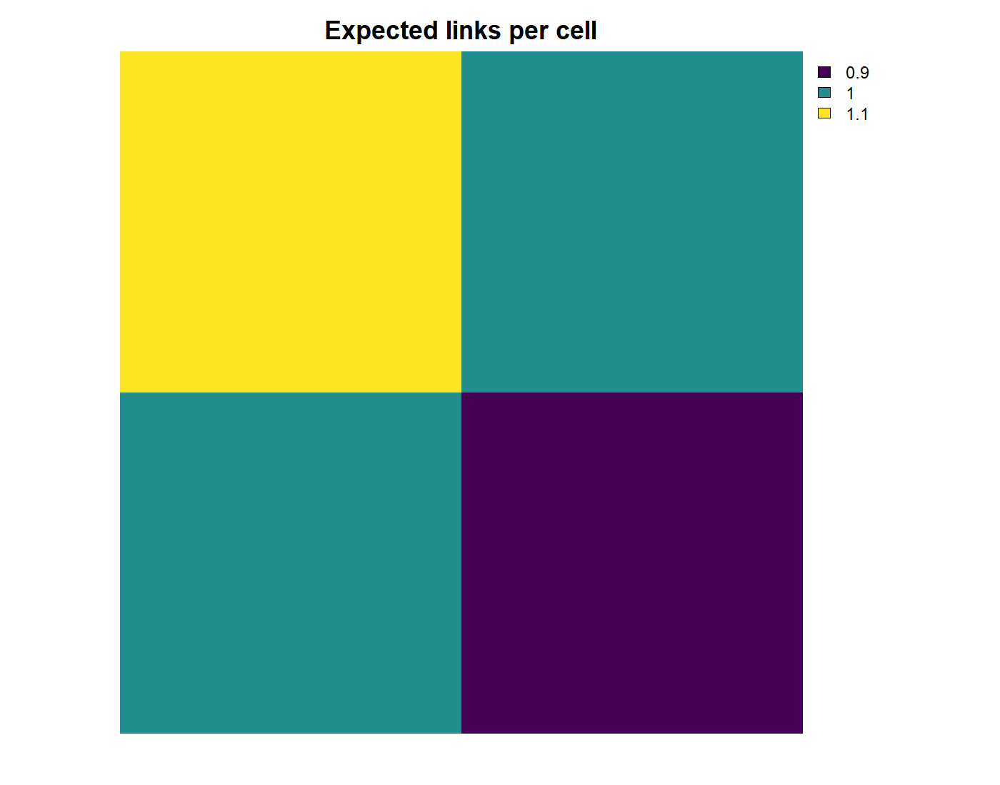

---
title: "MetaWeave: a reproducible framework for the spatial inference of ecological networks"
bibliography: references.bib
authors:
  - name: "Gabriel Munoz"
    affiliation: "Concordia University"
format:
  html:
    embed-resources: true
    toc: true
  docx:
    toc: true
execute:
  enabled: false
abstract: |
 A regional species-interaction network, or metaweb, describes interactions that potentially occur among species within a region. MetaWeave is an R package that combines regional metawebs, local species assemblages, and alternative interaction models to reconstruct local networks. Its main feature is to separate the effects of interaction assumptions from changes in community composition. We illustrate the package with three applications: a synthetic benchmark comparing interaction models against a known generating process; spatial downscaling of a Neotropical palm–mammal metaweb; and a reanalysis of six Ecuador plant–frugivore networks. In the Ecuador example, an externally fitted regional stochastic block model is applied to both observed and richness-matched alternative assemblages. Holding the observed assemblages fixed, the block model increased simulated nestedness relative to neutral link allocation at the two lowest sites, while the composition contrasts were less consistent across sites. These comparisons are conditional on species recorded in the interaction data and use a model fitted to the pooled networks. MetaWeave 1.0.0 is available on CRAN. By retaining local interaction matrices and allowing assemblages and interaction rules to vary independently, MetaWeave supports explicit comparisons of ecological network hypotheses across space.
---

# Introduction

Understanding the organization of ecological communities requires more than mapping species richness and their geographic ranges, as these alone do not capture how species interact. Ecological networks (e.g. producer-consumer networks) capture this variation by describing how interactions among species vary across space and time [@strydom2021roadmap]. Yet documenting ecological networks comprehensively remains difficult and costly at broad scales and high resolutions [@strydom2021roadmap; @banville2025probabilistic]. Regional metawebs offer a starting point to understand the geographic organization of ecological interactions [@saravia2022metaweb; @dansereau2024spatial]. Regional metawebs typically aggregate local data on species interactions across a region into a single binary or probabilistic (meta) network [@strydom2021roadmap; @banville2025probabilistic]. Therefore, regional metawebs inform about the interaction potential among species in a regional species pool [@saravia2022metaweb; @marjakangas2022]. When combined with spatially explicit species distribution maps, it becomes possible to infer where interactions may occur, including in communities that have not been directly sampled [@saravia2022metaweb; @dansereau2024spatial; @strydom2021roadmap].

Species co-occurrences provides opportunities for interaction, but whether species interact depends on factors such as trait compatibility, ecological roles, and environmental conditions. Consequently, communities with similar species richness may differ substantially in their interaction structure and responses to disturbance [@montoya2006fragility]. Several modelling approaches describe how species distributions, functional traits and environmental conditions can inform local network inference from a regional metaweb [@strydom2021roadmap; @saravia2022metaweb; @marjakangas2022]. However, available implementations remain fragmented, and general software tools for the spatial analysis of regional metawebs are limited [@ohlmann2023metanetwork]. This limits the ability to systematically translate regional interaction information into spatially explicit predictions of local network structure. A common framework would make these analyses easier to reproduce, extend and compare across systems.

MetaWeave is an R package that integrates local spatial network inference within a modular and reproducible framework. Building on capabilities available in existing open-source tools, MetaWeave combines spatially explicit species assemblages with regional metawebs to generate local interaction matrices, retaining species-pair probabilities for subsequent analysis. By separating species distribution data, interaction models, and network outputs into interchangeable components, MetaWeave enables users to explore spatial variation in potential ecological networks and compare interaction assumptions within a consistent analytical workflow.

# Methods and features

## From species distributions to local assemblages

The spatial workflow takes one raster layer per species, organized into trophic levels or ecological guilds, with all layers sharing the same projection, extent, resolution, and grid alignment. Species names and species pools should be harmonized across distribution data and interaction models. MetaWeave uses the `terra` package to handle these raster data and determine which species co-occur in each geographic cell [@hijmans2025terra]. Continuous occurrence probabilities must first be converted to presence–absence maps. Geographic cells are kept only if they contain at least one species, or any user-defined number, from each trophic level or ecological guild. Each retained geographic cell represents a local assemblage composed of the species present in that cell. Assemblages can also be supplied directly as site-level species lists, as in the Ecuador case study. At this stage, species co-occurrence represents an opportunity for interaction [@strydom2021roadmap; @dansereau2024spatial]; interactions are inferred in the following step.

## A common interface for interaction inference

For each local assemblage, MetaWeave applies an inference model through a common interface:

$$\widehat{G}_{\ell}=\mathcal{I}(C_{\ell},M),$$

where $\widehat{G}_{\ell}$ is the inferred network at locality $\ell$, $C_{\ell}$ is its species assemblage, $M$ is the supplied model and $\mathcal{I}$ is the inference procedure.

The inferred local network is represented as an interaction matrix, with entries corresponding to binary links, interaction probabilities, or weights depending on the interaction model. Local matrices are retained together with cell identifiers and coordinates, allowing network summaries to be mapped while preserving the underlying species interactions.

## Alternative models of interaction formation

MetaWeave supports several ways to translate regional metawebs into local species assemblages with their respective predicted interaction networks. Available approaches to users mainly differ in how interaction probabilities are specified, while keeping stable the spatial definition of local communities [@strydom2021roadmap; @banville2025probabilistic].

**Species-pair probability matrices.** MetaWeave can use a species-by-species matrix containing interaction probabilities between zero and one. For each local assemblage, the corresponding rows and columns are extracted to define the local interaction matrix. These probabilities may come from trait-matching models, expert inputs, or other external analyses [@banville2025probabilistic]. A binary regional metaweb can be used in the same way, with one indicating a recorded regional interaction and zero an unrecorded pair. MetaWeave uses these matrices as supplied and does not fit the underlying interaction model.

**Stochastic block models.** Species can also be assigned to ecological guilds (i.e. blocks), with interaction probabilities defined between blocks rather than individual species [@banville2025probabilistic]. Species belonging to the same block therefore share the same interaction probabilities with species in another block. For each local assemblage, MetaWeave expands these block-level probabilities into a species-level interaction matrix. Model fitting and block selection remain external to MetaWeave and can therefore be carried out using any suitable modelling framework [@terry2024cassandra].

**User-defined models.** MetaWeave also allows users to provide their own interaction model. Predictions can depend on the species present in a cell as well as contextual information such as location, environmental conditions, or species traits [@strydom2021roadmap; @banville2025probabilistic]. The prediction function is supplied by the user, while MetaWeave handles its application across local assemblages and the resulting spatial outputs. This allows alternative ecological hypotheses to be evaluated within the same spatial workflow without requiring MetaWeave to fit the underlying model. While species-pair matrices provide fixed interaction values that are simply subset to each local assemblage, user-defined models calculate interaction values dynamically for each assemblage and can incorporate local environmental or trait information.

Figure 1 summarizes this separation of inputs. Local assemblages can change while the interaction model stays fixed, or alternative models can be applied to the same assemblages. The output in either case is a collection of local species-pair matrices that can be summarized or analysed with other network tools.

{#fig-workflow}

# Main functions

MetaWeave is organized around a small set of functions corresponding to the main steps of the workflow. Additional helper functions for preparing spatial inputs, constructing network objects, simulation, and metric calculation are described in the package repository and documentation.

- `assemble_communities(distributions, min_species = 1L)` builds local assemblages from a named list of aligned species-distribution rasters. `min_species` sets the minimum number of species required in each ecological group for a cell to be retained.

- `probability_matrix_model(probability_matrix, row_group, column_group, name = "species probability matrix")` defines fixed species-pair interaction probabilities, or binary regional links, between two ecological groups.

- `block_model(row_lookup, column_lookup, theta, row_group, column_group, species_col = "species", guild_col = "guild")` defines interaction probabilities among ecological blocks or guilds and expands them to the species represented in each local assemblage.

- `new_inference_model(predict, name = "custom", parameters = list(), subclass = NULL)` creates a user-defined inference model. The supplied `predict` function receives the model and a local assemblage and returns an ecological network.

- `infer_network(assemblage, model)` applies an interaction model to a single local assemblage.

- `infer_networks(assemblages, model, template = NULL)` applies the same model across a collection of local assemblages and retains their cell identifiers and coordinates.

- `reconstruct_networks(distributions, model, min_species = 1L)` combines assemblage construction and network inference across the distribution data.

- `run_spatial_inference(distributions, model, min_species = 1L, threshold = NULL)` runs the complete spatial workflow, including local assemblage construction, network inference, network summaries, and mapping of the resulting metrics.

## Minimal example

The following example uses made-up species, a two-by-two probability matrix, and a four-cell spatial grid. It needs only the released `metaweave` package and its `terra` dependency; no external data or model fitting are required. Rows of `p` are plants and columns are animals. Each entry is a supplied interaction probability conditional on both species being present, not an occurrence probability estimated by MetaWeave.

``` r
library(metaweave)

## Define probability matrix 
p <- matrix(c(0.8, 0.2, 0.3, 0.7), 
            nrow = 2, byrow = TRUE,
            dimnames = list(c("plant_a", "plant_b"),
                            c("animal_x", "animal_y")))

## Create model object
model <- probability_matrix_model(p, "plants", "animals")
## Create spatial grid 
grid <- create_standard_grid(c(0, 2, 0, 2), resolution = 1)
## Map plant and animal distribution
plants <- terra::rast(list(grid, grid))
animals <- terra::rast(list(grid, grid))
names(plants) <- rownames(p)
names(animals) <- colnames(p)
terra::values(plants) <- cbind(c(1, 1, 0, 1), c(1, 0, 1, 1))
terra::values(animals) <- cbind(c(1, 1, 1, 0), c(0, 1, 1, 1))

## Run spatial inference workflow 
result <- run_spatial_inference(
  list(plants = plants, animals = animals),
  model, 
  min_species = 1
)

## Extract results 
result$result$index[, c("cell_id", "expected_links")]
## Plot results
terra::plot(result$spatial$data[["expected_links"]],
            main = "Expected links per cell", axes = FALSE)
```

The index reports expected links of 1.1, 1.0, 1.0, and 0.9 for cells 1–4, respectively (Fig. 2). These are sums of the retained pair probabilities, not observed link counts. The local interaction matrices remain available in `result$result$networks`. The package's getting-started vignette explains the same workflow in more detail.

{#fig-example}

# Synthetic evaluation benchmark

We evaluated MetaWeave using a synthetic bipartite system with 24 producer species, 18 consumer species, and 225 spatial cells distributed along an environmental gradient. Species distributions generated spatial turnover among cells, whereas local interaction probabilities varied with block structure, species-pair heterogeneity, and environmental context. We compared three inference models: a block model, a regional species-pair probability model, and a data-generating model supplied with the true data-generating process. All three models were applied to the same local assemblages.

The data-generating model recovered the interaction probabilities exactly, with zero probability RMSE (Fig. 3A) and expected connectance values that fell on the one-to-one line (Fig. 3B). This simply confirms that the custom-model and spatial workflow preserve the probabilities they are given. Among the two alternative models, the regional species-pair model was closer to the generating process than the block model. It had lower probability RMSE (0.112 vs. 0.147; Fig. 3A), lower Brier score and log loss (Fig. 3C), and slightly lower errors for expected links and connectance. Both models reproduced the broad pattern in expected connectance, but the species-pair model remained closer to the true values (Fig. 3B).

These results show that MetaWeave carries differences among interaction models through the same spatial workflow. In this example, the stochastic block model was not necessarily a poor model; it is simply less well matched to this particular simulated system, where interactions varied strongly among individual species pairs. This benchmark should therefore be taken as an overall workflow demonstration rather than a ranking of model classes. The simulation and scoring workflow is provided in Supplementary material 1 (`S1-synthetic-benchmark.qmd`).

![**Synthetic evaluation of spatial network inference with MetaWeave.** (A) Site-level RMSE between predicted and generating interaction probabilities across 225 cells. (B) Predicted versus generating expected connectance; the dashed line denotes equality. (C) Brier score and logarithmic loss against sampled binary interactions. The data-generating model is the oracle and has zero probability and connectance error by construction. Its nonzero scores against binary interactions reflect stochastic realization. All models use identical assemblages.](images/synthetic_benchmark.png){#fig-benchmark}

# Case studies

## Case study 1: Downscaling a palm–mammal frugivory neotropical seed dispersal metaweb

We used a Neotropical palm–mammal interaction dataset to translate regional interaction information into spatial predictions. Interaction records from @munoz2019seed were combined with palm and mammal range maps, with species names standardized and duplicate records removed. The matched dataset included 51 palm species, 68 mammal species, and 234 recorded interactions. Local communities were defined on a 1° WGS84 grid, retaining cells with at least one species from each group. Palm and mammal richness varied across the region (Fig. 4A,B). Supplementary material 2 details the regional inputs, MetaWeave reconstruction and map calculations.

We compared two ways of translating the same regional network to local communities: retaining recorded links when species co-occurred, or assigning probabilities with a stochastic block model fitted in `cassandRa` 0.2.0 [@terry2024cassandra]. Both approaches used the same local assemblages. Across 1,254 cells, the recorded-metaweb approach produced 21.17 possible links on average, compared with 12.11 expected links under the block model. Their broad spatial patterns were similar, but the block model generally predicted fewer interactions (Fig. 4C,D), with the largest differences concentrated along the Yungas and the Andean–Amazon transition zone (Fig. 4E).

The lower number of expected links under the block model reflects a different way of translating the same regional interaction information to local communities. The model can assign some probability to species pairs that were not recorded regionally while also reducing the expected contribution of recorded pairs from one to a value below one. As a result, the differences in Fig. 4E show where the two interaction assumptions lead to different local network predictions. This is the main value of the comparison: by keeping local species composition unchanged, MetaWeave makes it possible to identify where interaction models agree, where they differ, and where additional local sampling may be most informative. Without a separate validation step, these predictions describe potential local interaction structure rather than confirmed encounters or seed-dispersal effectiveness. The regional inputs, local reconstruction, and map workflow are provided in Supplementary material 2.

![**Palm–mammal network reconstructions from the same local assemblages. (A–B) Richness of retained palm and mammal species.** (C) Recorded regional links whose species co-occur locally. (D) Sum of block-model probabilities, expressed as expected links. (E) Expected block-model links minus recorded-baseline links. Panels C and D use the same colour limits; panel E uses a symmetric scale centred on zero. Positive and negative differences reflect redistribution of probability across recorded and unrecorded pairs. Blank cells fall outside the eligible assemblages. The maps show model-dependent interaction potential, not observations of realized interactions.](images/palm_mammal_case_study.png){#fig-palms}

## Case study 2: Community and interaction assembly in Ecuador plant–frugivore networks

We used MetaWeave and the six plant– bird frugivore networks provided in [@marjakangas2022; @munoz2021traitbased] to infer the effects of community and interaction assembly process in network structure across an elevational gradient in the Andes of Ecuador. Their interaction records define 102 plant and 127 frugivore species and 536 distinct regional pairs. We pooled the recorded links across sites into one binary metaweb and fitted a bipartite stochastic block model to it with `cassandRa` [@terry2024cassandra]. The selected fit assigned plants and frugivores to ten blocks each. This model was fitted only at the regional level. At each site, MetaWeave applied the same block memberships and block-pair probabilities to the locally recorded species, yielding a probability-valued interaction matrix.

We compared three fixed-link-count ensembles at each site. **A** retained the observed plant and frugivore species and allocated links uniformly among eligible pairs. **B** retained those species and allocated links using the regional block-model probabilities as sampling weights. **C** sampled plants and frugivores with equal probability from their respective regional pools, preserving the site's richness in each group, and applied the same block model. Each realization contained the site's observed number of distinct links. The **B − A** contrast isolates the change in interaction rule at fixed composition; **B − C** changes composition under a fixed regional rule. We calculated binary NODF nestedness with `vegan` and bipartite modularity with `bipartite` for the observed networks and 49 realizations per scenario. The regional-pool randomization assumes equal selection probability and does not represent habitat filtering or dispersal limitation. The scripts, fit and metric settings are documented in Supplementary material 3.

At the two 1,000-m sites, the regional block model produced more nested networks than uniform link allocation with the same local species and link count: mean B − A differences were 13.0 NODF units at Bombuscaro and 15.9 at Copalinga (Fig. 5A). The corresponding modularity differences were about −0.05 at both sites (Fig. 5B). At the 2,000-m sites, the nestedness contrast was smaller (4.2–4.6 units), and at the 3,000-m sites its simulation interval included zero. The composition contrasts B − C were less consistent: their 95% simulation intervals included zero for nestedness at all six sites, although the two 1,000-m sites showed lower modularity under their observed assemblages than under richness-matched random assemblages.

![**The assembly of networks between fleshy-fruited plants - bird frugivores across an elevational gradient in Ecuador.** (A) Difference in binary NODF nestedness and (B) difference in bipartite modularity across six sites ordered by elevation. Circles show the interaction-rule contrast B − A: the regional SBM-weighted ensemble minus the uniform-link ensemble for the same local species. Triangles show the composition contrast B − C: observed local species minus richness-matched random species under the same regional SBM. Points are means and vertical lines span the central 95% of 49 paired simulation differences. All ensembles preserve each site's observed plant richness, frugivore richness and number of distinct links. These are in-sample structural comparisons; the intervals describe simulation variation rather than uncertainty over Ecuador sites. These differences are in the metric's original units, not standardized scores.](images/ecuador_assembly.png){#fig-ecuador}

# Discussion

## Relationship to existing software

MetaWeave overlaps with existing tools in its use of regional interaction information and local networks, while providing an explicit interface between **assemblages** and **interaction models**. The following comparison locates that contribution within the software used in this study. The distinctions concern documented workflows, not a claim that other packages cannot be extended by users.

| Software | Documented role | Relationship to MetaWeave |
|------------------------|------------------------|------------------------|
| `metanetwork` | Builds, analyses and visualizes regional trophic metawebs and local networks from a metaweb and optional community or trophic information [@ohlmann2023metanetwork]. | Shares the regional-to-local network setting; MetaWeave exposes alternative inference models as interchangeable inputs to the same local assemblages. |
| `net.raster` | Combines species-distribution rasters and a bipartite interaction network to map network and species-level metrics [@oliveira2025netraster]. | Shares raster-based spatial analysis; MetaWeave retains each local pair matrix and permits supplied pair probabilities, block probabilities or user-defined predictions. |
| `cassandRa` | Fits statistical models to bipartite interaction data, including stochastic block models and estimates of missing links [@terry2024cassandra]. | Supplies fitted block memberships and probabilities; MetaWeave applies those parameters to observed or alternative local assemblages without refitting. |

## Intended uses, limitations and future extensions

MetaWeave provides a reproducible framework for examining how assumptions about species interactions and changes in community composition influence predictions of ecological network structure [@strydom2021roadmap; @banville2025probabilistic]. The synthetic benchmark shows how alternative interaction models can be evaluated against a known generating process. The palm–mammal application compares two interaction assumptions on identical spatial assemblages. The Ecuador application shows the complementary use: a fitted regional interaction model can be held fixed while local species identities change. Its nestedness and modularity contrasts suggest that interaction assumptions can matter even when richness and link count are controlled, but the fitted block model did not reproduce all observed structure. Together, the applications illustrate the value of varying assemblages and models independently.

Metaweave allows the reconstruction of both binary (presence/absence) and probabilistic interaction networks. When inferring bipartite probability matrices, summing pairwise interaction probabilities gives the expected number of links without requiring interactions to be independent. However, these marginal probabilities do not describe whether particular interactions tend to occur together, exclude one another, or otherwise depend on the structure of the realized network [@banville2025probabilistic]. Such dependencies require additional assumptions about network realization. As a result, nonlinear properties such as nestedness or robustness cannot generally be obtained by simply evaluating the probability matrix directly, because this is not equivalent to averaging those properties across possible binary-network realizations [@banville2025probabilistic]. Nonlinear network properties can instead be estimated from repeated binary realizations of each local probability matrix, with the realization model specifying any dependence among interactions [@banville2023maxent; @banville2025probabilistic].

MetaWeave outputs depend on the quality of the input data and the assumptions used [@strydom2021roadmap; @banville2025probabilistic]. Errors in species distributions, taxonomy, or interaction records can affect local predictions, and broad range overlap may overestimate where species actually meet. Block models may reflect uneven sampling because unrecorded interactions are treated as zeros [@banville2025probabilistic]. In the Ecuador comparison, species that were present but never recorded interacting are absent from the inferred assemblages, and equal-probability sampling from the regional pool omits environmental filtering and dispersal differences. The pooled block model also includes information from every focal site, so the case is a structural reanalysis rather than an independent prediction test. Users can include abundance, phenology, or environmental effects when these are part of the interaction model, but MetaWeave does not infer them automatically. Uncertainty can be explored by repeating reconstructions with alternative assemblages or models. Network metrics such as connectance, nestedness, or modularity should therefore be treated as model-based predictions until validated with independent local observations [@dansereau2024spatial; @banville2025probabilistic].

MetaWeave 1.0.0 also includes an experimental `maxent_model()` option for generating binary-network ensembles constrained by connectance, an exact link count, or a specified degree sequence [@banville2023maxent]. These ensembles can support null-model tests and sensitivity analyses of network properties such as nestedness or modularity; those properties are outputs to evaluate, not constraints imposed by this function. The link-count route samples uniformly under its exact count constraint. The degree-sequence route uses an approximate swap-chain sampler without a built-in convergence diagnostic, so its sampling behavior requires further evaluation. Future priorities include improved uncertainty propagation, more informative error diagnostics, and more memory-efficient processing for large spatial applications.

## Software and data availability

MetaWeave 1.0.0 is available on [CRAN](https://cran.r-project.org/package=metaweave) under the MIT license and requires R ≥ 4.1.0. The package imports `terra` for raster operations and base R's `methods` and `stats` packages for object methods and statistical operations; its source code, documentation, and installation instructions are available from the [MetaWeave repository](https://github.com/fgabriel1891/metaweave). The synthetic benchmark and palm–mammal workflows are supplied in Supplementary materials 1 and 2. Ecuador interaction records and traits are archived by @munoz2021traitbased; Supplementary material 3 contains the pooled-SBM fit, local reconstruction, and table and figure scripts used here.
